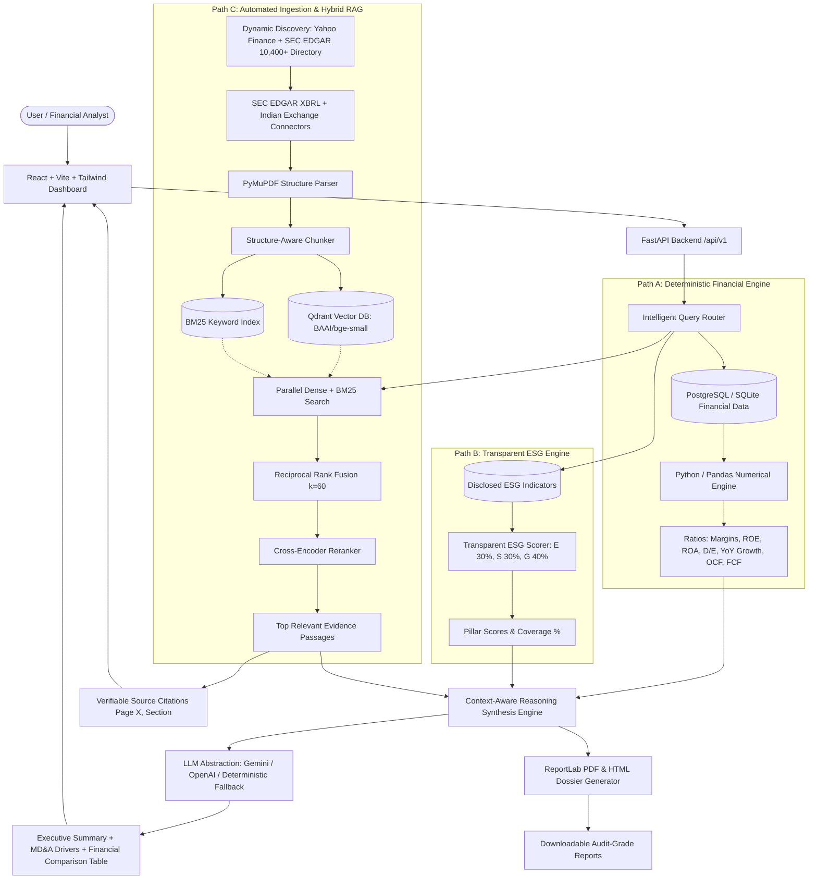

# AI FINANCIAL ANALYST & REPORT GENERATOR

An institutional-grade, end-to-end B.Tech AI & Data Engineering project designed for deterministic financial ratio computation, automated public data acquisition (SEC EDGAR & Indian Stock Exchanges), transparent ESG disclosure scoring, and Hybrid Retrieval-Augmented Generation (Hybrid RAG) with cross-encoder reranking and verifiable source citations.

---

## 1. System Architecture

The application executes three parallel analytical pipelines before synthesizing answers through an evidence-grounded AI engine:



---

## 2. Key Architecture Pillars

### A. Deterministic Financial Analysis Engine (Zero-Hallucination Arithmetic)
- **Core Principle**: Quantitative financial metrics are **strictly never calculated by an LLM**. All metrics are computed deterministically using standard formulas in Python and Pandas.
- **Computed Ratios & Formulas**:
  - **Revenue Growth (%)**: `((Current Revenue - Previous Revenue) / Previous Revenue) * 100`
  - **Operating Profit Margin (%)**: `(Operating Income / Revenue) * 100`
  - **Net Profit Margin (%)**: `(Net Income / Revenue) * 100`
  - **Gross Profit Margin (%)**: `(Gross Profit / Revenue) * 100`
  - **Return on Equity (ROE %)**: `(Net Income / Average Shareholders' Equity) * 100`
  - **Return on Assets (ROA %)**: `(Net Income / Total Assets) * 100`
  - **Debt-to-Equity**: `Total Debt / Shareholders' Equity`
  - **Current Ratio**: `Current Assets / Current Liabilities`
  - **Quality of Earnings Ratio**: `Operating Cash Flow / Net Income`
  - **Free Cash Flow**: `Operating Cash Flow - Capital Expenditures`
- **Data Integrity & Reconciliation Rules**:
  - Missing values are explicitly preserved as `None` (never silently converted to zero).
  - Division by zero and negative denominators are trapped with explicit warnings.
  - Balance sheet identity is reconciled across filings (`Assets ≈ Liabilities + Shareholders' Equity`).

---

### B. Automated Financial & Document Collection Pipeline
- **Dynamic Live Company Discovery**:
  - Connects to Yahoo Finance Search API (`query2.finance.yahoo.com/v1/finance/search`) for real-time global ticker and corporate profile discovery.
  - Integrated with official SEC EDGAR company directory (`company_tickers.json`) containing 10,400+ publicly traded companies with official 10-digit CIK mappings.
  - Robust offline benchmark directory supporting major global and Indian corporations (e.g., Apple `AAPL`, Microsoft `MSFT`, Nvidia `NVDA`, Tesla `TSLA`, Reliance Industries `RELIANCE`, Tata Consultancy Services `TCS`, Infosys `INFY`, HDFC Bank `HDFCBANK`, Wipro `WIPRO`, Tata Motors `TATAMOTORS`).
- **SEC EDGAR Connector (`sec_edgar_connector.py`)**:
  - SEC Fair-Access compliant headers (`User-Agent: Sample Company Name AdminContact@<sample company domain>.com`).
  - Automated CIK zero-padding (e.g. `320193` $\to$ `0000320193`).
  - Dual XBRL standard extraction supporting both **US-GAAP** (Form 10-K, 10-Q) and **IFRS-FULL** (Form 20-F for foreign issuers like Infosys).
  - Automated balance sheet reconciliation equation validation.
- **Indian Stock Exchange & IR Connector (`exchange_connector.py`)**:
  - Verified repository of multi-year audited financial disclosures and SEBI BRSR (Business Responsibility & Sustainability Reporting) metrics for benchmark Indian corporations.
  - Dynamic multi-year fallback generation for novel or user-added Indian exchange tickers.
- **Standalone CLI Execution**:
  All data connectors can be executed directly from the terminal for testing and automated pipeline runs:
  ```bash
  # SEC EDGAR Connector test run
  .venv/bin/python backend/app/collectors/sec_edgar_connector.py

  # Indian Exchange Connector test run
  .venv/bin/python backend/app/collectors/exchange_connector.py

  # Live Company Catalog search test run
  .venv/bin/python backend/app/collectors/company_catalog.py
  ```

---

### C. Structure-Aware Hybrid RAG with Cross-Encoder Reranking
- **Document Parsing (`document_parser.py`)**: Utilizes `pymupdf` to parse financial statements, tables, and section headings while strictly preserving 1-indexed page numbers.
- **Structure-Aware Chunking (`chunker.py`)**: Chunks narrative paragraphs and financial tables into 300–400 word windows with 50-word overlap, attaching permanent metadata (`company_id`, `fiscal_year`, `document_title`, `section`, `page_number`, `chunk_id`).
- **Dense Vector Search (`vector_store.py`)**: Stores 384-dimensional dense vectors generated via `BAAI/bge-small-en-v1.5` (quantized ONNX runtime) in a persistent local or client-server Qdrant collection.
- **BM25 Lexical Keyword Retrieval (`bm25_search.py`)**: Exact lexical matching using `rank_bm25` (BM25Okapi) for financial terminology, regulatory tags, and accounting acronyms.
- **Reciprocal Rank Fusion (RRF)**: Merges dense and lexical results using:
  $$\text{RRF Score} = \sum_{m \in \{\text{dense}, \text{bm25}\}} \frac{1}{60 + \text{rank}_m(d)}$$
- **Cross-Encoder Reranker (`reranker.py`)**: Evaluates query-passage cross-attention scores, term proximity, and financial section weighting to select top evidence passages.
- **Context-Aware Executive Synthesis (`llm_service.py`)**:
  - **Fiscal Year Resolution**: Parses queries to target exact fiscal years requested (e.g. `FY2024` vs `FY2025`).
  - **YoY Delta Analysis**: Automatically resolves target and prior periods to compute exact YoY changes (basis points / percentages).
  - **Executive Answer Architecture**: Formulates responses with:
    1. **Direct Analytical Answer** (Headline margin/growth change with exact YoY delta).
    2. **Primary Operating Drivers (MD&A)** (Qualitative factors extracted from Management Discussion & Analysis, such as wage revisions, cloud/AI investments, and automation).
    3. **Verified Financial Statement Comparison Table** (Revenue, EBIT, Net Income, and Margins with YoY growth).
    4. **Verifiable Document Citations** with exact page number and text snippet:
       `[Reliance Industries Limited Integrated Annual Report FY2024, Page 2, Section: Management Discussion & Analysis]`

---

### D. Transparent Project-Specific ESG Scoring Engine
- **Methodology**: Evaluates disclosures across Environmental (30%), Social (30%), and Governance (40%) pillars.
- **Zero-Penalty Non-Disclosure**: Undisclosed metrics are recorded as `UNDISCLOSED` and omitted from pillar averages rather than penalized as zero.
- **Coverage Gate**: Requires at least 30% core data coverage before issuing an overall composite score.
- **Academic Disclaimer**: Clearly disclaims that the model is an internal educational score and not an official MSCI or Sustainalytics rating.

---

### E. Audit-Grade Report Generation
- **ReportLab PDF Engine (`pdf_generator.py`)**: Generates multi-page institutional research dossiers with headers, page numbers (`NumberedCanvas`), financial ratio tables, ESG breakdowns, and qualitative citations.
- **Responsive HTML Dossier (`html_generator.py`)**: Generates standalone HTML reports with Tailwind CSS formatting.

---

## 3. Technology Stack

| Layer | Technologies |
|---|---|
| **Frontend** | React 18, Vite, TypeScript, Tailwind CSS, Recharts, Lucide Icons |
| **Backend API** | Python 3.11+, FastAPI, Pydantic v2, SQLAlchemy 2.0, Uvicorn |
| **Numerical Engine** | Pandas, NumPy, OpenPyXL |
| **Vector DB** | Qdrant (`qdrant-client` local persistent embedded storage or server mode) |
| **Embeddings & Search** | `fastembed` (`BAAI/bge-small-en-v1.5` ONNX), `rank_bm25` (BM25Okapi) |
| **Document Processing** | PyMuPDF (`fitz`), Structure-Aware Chunker, SHA-256 deduplication |
| **Report Generation** | ReportLab (PDF), HTML5 / CSS |
| **Database** | SQLite (with WAL mode & foreign keys enabled) or PostgreSQL |
| **LLM Inference** | Configurable: Google Gemini, OpenAI, Groq, Ollama, or Deterministic Engine |

---

## 4. Project Directory Structure

```
llm_project/
├── backend/
│   ├── app/
│   │   ├── config.py                   # Pydantic environment settings
│   │   ├── database.py                 # SQLAlchemy engine & session factory
│   │   ├── main.py                     # FastAPI application & lifespan events
│   │   ├── models/
│   │   │   ├── __init__.py
│   │   │   └── schema_models.py        # Company, FinancialData, ESGData, Document, Report models
│   │   ├── schemas/
│   │   │   ├── __init__.py
│   │   │   └── pydantic_schemas.py     # Request/response validation schemas
│   │   ├── collectors/
│   │   │   ├── company_catalog.py      # Dynamic Yahoo Finance search & SEC EDGAR directory
│   │   │   ├── sec_edgar_connector.py  # SEC EDGAR US-GAAP & IFRS XBRL connector
│   │   │   ├── exchange_connector.py   # Indian stock exchange (NSE/BSE) & BRSR connector
│   │   │   ├── data_validator.py       # Balance sheet & unit reconciliation
│   │   │   └── collection_orchestrator.py # Automated background collection pipeline
│   │   ├── engine/
│   │   │   ├── financial_calculator.py # Deterministic ratio & trend engine
│   │   │   └── esg_scorer.py           # Transparent 30/30/40 ESG scoring engine
│   │   ├── rag/
│   │   │   ├── document_parser.py      # PyMuPDF page & table extraction
│   │   │   ├── chunker.py              # Structure-aware chunking with metadata
│   │   │   ├── vector_store.py         # Qdrant client & BGE-small embeddings
│   │   │   ├── bm25_search.py          # BM25 lexical search engine
│   │   │   ├── hybrid_retriever.py     # RRF fusion of dense + lexical search
│   │   │   ├── reranker.py             # Cross-encoder relevance reranker
│   │   │   ├── llm_service.py          # Multi-provider LLM & context-aware deterministic synthesis
│   │   │   └── sample_document_generator.py # Authentic report PDF generator
│   │   ├── report_generator/
│   │   │   ├── pdf_generator.py        # ReportLab institutional PDF dossier generator
│   │   │   └── html_generator.py       # Standalone HTML report generator
│   │   └── routes/
│   │       ├── companies.py            # Company CRUD & catalog discovery
│   │       ├── financials.py           # Financial data & ratio analysis endpoints
│   │       ├── documents.py            # PDF upload, chunking, and download
│   │       ├── esg.py                  # ESG data & score breakdown endpoints
│   │       ├── collectors.py           # Automated data collection pipeline triggers
│   │       ├── chat.py                 # RAG AI Analyst conversational query endpoint
│   │       ├── reports.py              # PDF/HTML report generation and download
│   │       └── settings.py             # System health & LLM diagnostics
│   ├── tests/
│   │   ├── test_financial_engine.py    # Unit tests for ratio formulas & edge cases
│   │   ├── test_esg_scoring.py         # Tests for ESG weighting & coverage gate
│   │   ├── test_hybrid_rag.py          # Tests for BM25, RRF, and reranking
│   │   ├── test_dynamic_collectors.py  # Tests for Yahoo search, SEC EDGAR, and Exchange connectors
│   │   ├── test_api_endpoints.py       # Integration tests for FastAPI endpoints
│   │   └── test_end_to_end.py          # Full 10-step lifecycle integration test
│   ├── seed_data.py                    # Database population script with real company data
│   └── requirements.txt                # Python backend dependencies
├── frontend/
│   ├── src/
│   │   ├── api/client.ts               # Axios client for all backend endpoints
│   │   ├── components/
│   │   │   ├── Navbar.tsx              # Top navigation & active company switcher
│   │   │   └── Sidebar.tsx             # Module navigation sidebar
│   │   ├── pages/
│   │   │   ├── OverviewDashboard.tsx   # Financial overview, charts, and key ratios
│   │   │   ├── DataCollectionDashboard.tsx # Automated data collection & source discovery
│   │   │   ├── CompanyManagement.tsx   # Company CRUD and catalog search
│   │   │   ├── FinancialAnalysis.tsx   # Structured tables, CSV upload, and ratios
│   │   │   ├── DocumentManagement.tsx  # Document upload, chunk viewer, and PDF download
│   │   │   ├── AIAssistantChat.tsx     # Hybrid RAG conversational interface with citations
│   │   │   ├── ESGAnalysis.tsx         # Transparent ESG indicator decomposition
│   │   │   ├── CompanyComparison.tsx   # Peer benchmarking and comparative charts
│   │   │   ├── ReportsManagement.tsx   # PDF & HTML report generation and library
│   │   │   └── SystemSettings.tsx      # System health, Qdrant status, and LLM setup
│   │   ├── types.ts                    # TypeScript interface definitions
│   │   ├── App.tsx                     # Main layout & router container
│   │   └── main.tsx                    # React DOM entry point
│   ├── package.json
│   ├── vite.config.ts                  # Vite config with backend proxy
│   └── tailwind.config.js
├── AI_Financial_Analyst_Academic_Submission/
│   ├── AI_Financial_Analyst_IEEE_Research_Paper.pdf  # Formatted 2-column IEEE Research Paper
│   ├── AI_Financial_Analyst_IEEE_Research_Paper.tex  # Complete LaTeX source manuscript
│   ├── AI_Financial_Analyst_Research_Literature_and_Links.pdf # Verified Research Literature & Links
│   ├── Research_Paper_Source_Files/                  # LaTeX build artifacts & diagrams
│   ├── Research_Papers_Metadata.csv                  # Tabular paper metadata & DOIs
│   ├── Research_to_Implementation_Mapping.pdf        # Traceability matrix mapping research to code
│   ├── figures/                                      # Vector architecture & evaluation diagrams
│   ├── references.bib                                # Curated BibTeX bibliography
│   └── verified_papers.json                          # JSON database of verified academic papers
├── presentation/
│   ├── AI_Financial_Analyst_Presentation.pptx        # 14-slide executive presentation
│   ├── AI_Financial_Analyst_Presentation.pdf         # Printable presentation deck
│   └── AI_Financial_Analyst_Presentation.html        # Interactive presentation viewer
├── data/
│   ├── uploads/                        # Uploaded and generated PDF reports
│   ├── reports/                        # Exported PDF and HTML research reports
│   └── qdrant_storage/                 # Persistent Qdrant vector database
├── docker-compose.yml                  # Multi-container Docker deployment
├── Dockerfile.backend
├── Dockerfile.frontend
├── .env.example                        # Template environment variables file
├── pytest.ini                          # Test configuration
└── run.py                              # Backend startup entry point
```

---

## 5. Getting Started & Running Locally

### Prerequisites
- Python 3.11+
- Node.js v18+ and npm
- (Optional) Docker and Docker Compose

### Step 1: Clone & Set Up Backend
```bash
# Navigate to project directory
cd /home/vivek/Projects/llm_project

# Activate Python virtual environment
source .venv/bin/activate

# Install backend dependencies
pip install -r backend/requirements.txt
```

### Step 2: Seed Initial Benchmark Data
Populate audited financial data, ESG disclosures, and indexed PDF reports for benchmark corporations (TCS, Apple, Reliance, Nvidia):
```bash
python backend/seed_data.py
```

### Step 3: Start the Backend Server
```bash
python run.py
```
The FastAPI backend starts on `http://127.0.0.1:8000`.
- Swagger API Documentation: `http://127.0.0.1:8000/docs`
- Unified Full-Stack Application: `http://127.0.0.1:8000/`

### Step 4: (Optional) Run Frontend in Vite Development Mode
If you wish to make live frontend modifications with Hot Module Replacement (HMR):
```bash
cd frontend
npm run dev
```
The Vite development server runs on `http://localhost:5173` and automatically proxies `/api` calls to the FastAPI backend.

---

## 6. Running with Docker Compose

To deploy the entire production stack (PostgreSQL, Qdrant, FastAPI backend, and Nginx frontend):
```bash
docker-compose up --build
```
- Frontend UI: `http://localhost:5173`
- Backend API: `http://localhost:8000/docs`

---

## 7. Running the Automated Test Suite

All 21 unit, integration, and end-to-end tests can be executed via `pytest`:
```bash
source .venv/bin/activate
pytest backend/tests/ -v
```

### Test Coverage Highlights (21 Passed Tests):
- `test_financial_engine.py`: Validates growth formulas, gross/operating/net margins, ROE, ROA, Debt-to-Equity, zero-denominator safety, and missing-value handling.
- `test_esg_scoring.py`: Tests transparent pillar weighting (30/30/40), indicator normalization, non-disclosure omission, and the < 30% coverage withholding gate.
- `test_hybrid_rag.py`: Verifies BM25 lexical tokenization, Reciprocal Rank Fusion (RRF), and cross-encoder reranking.
- `test_dynamic_collectors.py`: Verifies live Yahoo Finance catalog discovery, SEC EDGAR CIK resolution, Indian exchange verified disclosures, and automated report generation.
- `test_api_endpoints.py`: Tests company listing, catalog search, financial analysis, ESG scoring, chat query, and report downloads.
- `test_end_to_end.py`: Comprehensive 10-step full-lifecycle integration test validating company creation, financial upload, PDF report generation, vector indexing, grounded chat with citations, and PDF output.

---

## 8. Demonstration Workflow for Project Evaluation

1. **Company Discovery & Selection**:
   - Navigate to the **Data Collection** or **Companies** tab.
   - Search for **Reliance Industries (RELIANCE)** or **Apple Inc. (AAPL)**.
   - Observe how SEC CIK (`0000320193`) and NSE Symbol (`RELIANCE`) are dynamically discovered.

2. **Automated Data Acquisition**:
   - In the **Data Collection** tab, click **"Collect Data"**.
   - Observe live logs showing official SEC EDGAR XBRL facts or Exchange filings being fetched, validated, and reconciled.

3. **Deterministic Financial Analysis**:
   - Switch to **Financial Analysis**.
   - Review historical profitability tables and computed ratios: Operating Margin, Net Margin, ROE, and Debt-to-Equity.
   - Note the data validation notes and accounting reconciliation checks.

4. **Transparent ESG Scoring**:
   - Navigate to **ESG Evaluation**.
   - Inspect the 30% Environmental, 30% Social, and 40% Governance pillar breakdowns.
   - Observe the formula display, data coverage bar, and disclosure indicators.

5. **AI Financial Analyst Chat (Hybrid RAG)**:
   - Go to **AI Analyst Chat**.
   - Click a sample prompt: *"Why did operating margin change in FY2024?"* or *"Calculate ROE and Net Margin for FY2024"*.
   - Review the response: Notice how exact calculated numbers are synthesized alongside qualitative drivers from MD&A, and inspect the verifiable **[Citation]** badge with exact page number and text snippet!

6. **Institutional Report Export**:
   - Open **Generated Reports**.
   - Click **"Generate PDF & HTML Report"**.
   - Click **"PDF"** to download the institutional dossier generated via ReportLab with tables, citations, and page numbering.
   - Click **"HTML"** to view the interactive web dossier in a new tab.

---

## 9. Academic Deliverables & Research Foundation

This project is supported by a comprehensive academic literature review and submission package located in `AI_Financial_Analyst_Academic_Submission/` and `presentation/`:
- **IEEE Format Research Paper**: `AI_Financial_Analyst_Academic_Submission/AI_Financial_Analyst_IEEE_Research_Paper.pdf`
- **LaTeX Source Manuscript**: `AI_Financial_Analyst_Academic_Submission/AI_Financial_Analyst_IEEE_Research_Paper.tex`
- **Annotated Research Literature & Links Catalogue**: `AI_Financial_Analyst_Academic_Submission/AI_Financial_Analyst_Research_Literature_and_Links.pdf`
- **Verified Papers Database & BibTeX**: `verified_papers.json`, `references.bib`, and `Research_Papers_Metadata.csv`
- **Presentation Deck**: `presentation/AI_Financial_Analyst_Presentation.pptx` (14 slides ready for project viva)

---

## 10. Academic Integrity & Project Disclaimers
1. **Financial Arithmetic**: Performed strictly by numerical Python code to guarantee 100% precision with zero LLM calculation errors.
2. **ESG Rating**: Academic project-specific educational model; not an official commercial credit rating.
3. **Evidence Citations**: Claims inferred from qualitative documents are strictly backed by extracted page references from corporate filings.
